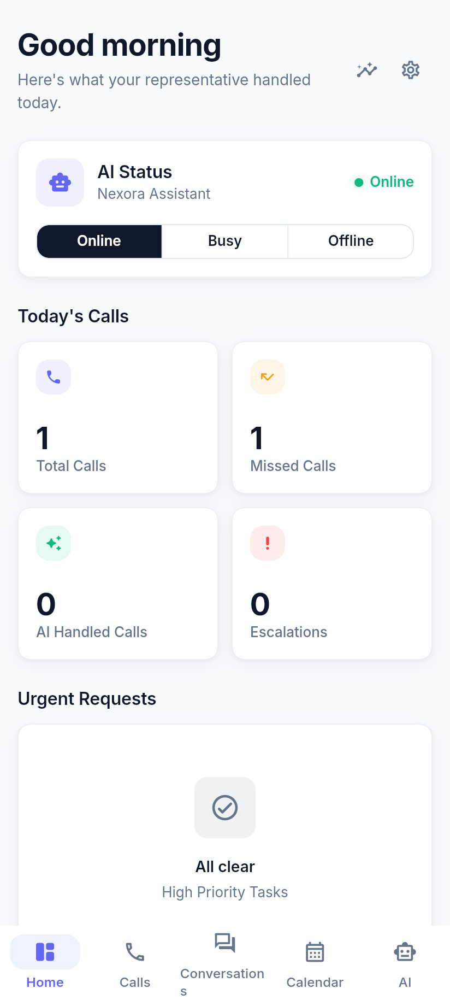
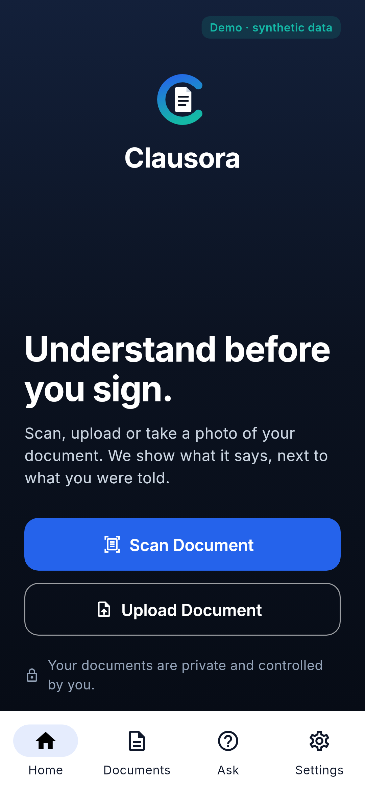

# Hi, I'm Dineshgopi Sunkara

Senior Controls Engineer · Automation Engineer

I build practical automation and AI-assisted tools designed to simplify professional work.

## Major projects

### ENVOEX — *Available when you can't be.*

AI digital representative mobile app that answers calls, books meetings, escalates urgent calls and summarizes conversations.

**Purpose**
- **Problem:** Small-business owners, workers and caregivers miss calls while working or caring for someone, which means lost customers, missed appointments or slow emergency response.
- **Who it serves:** Small businesses, workers and caregivers, with multilingual access for English, Hindi and Telugu speakers.
- **Public benefit (US):** Affordable AI call answering helps small businesses stay reachable and serves multilingual communities in their own language. Urgent calls go to a human quickly.
- **Original:** Real-time streaming voice (Pipecat), plus calendar-aware scheduling and a staged decision brain with escalation. It has a privacy firewall and always tells callers they are talking to an AI.
- **Status:** MVP / in development. Not in app stores. Internal benchmark (project notes): about 0.4 s from end of speech to first reply audio in English.
- **Roadmap:** Small-business pilot, production telephony, more languages, then a store release.

**Tech stack:** Flutter · FastAPI · Pipecat · WebRTC · PostgreSQL · Whisper/Vosk  
🔒 Private repo · Dineshgopi Sunkara — founder and sole developer/architect

 

### CLAUSORA — *Know before you sign.*

AI agreement and document review app that flags risky clauses in leases and contracts and explains them in plain language.

**Purpose**
- **Problem:** Renters and consumers sign leases and agreements they do not fully understand, often without access to a lawyer.
- **Who it serves:** Renters and consumers, starting with Washington residential leases under RCW 59.18.
- **Public benefit (US):** Consumer protection: people can spot risky or non-compliant clauses before signing.
- **Original:** Statute-cited rules decide the findings and the AI only explains them, so instructions hidden inside a document cannot change the result.
- **Status:** MVP / in development. Not deployed. Uses synthetic test data only.
- **Roadmap:** Full Washington coverage first, then more US states, multilingual support and user testing.

> Not legal advice. CLAUSORA provides general information and does not replace a licensed attorney.

**Tech stack:** Flutter · FastAPI · OCR · Rule engine · LLM explanations  
🔒 Private repo · Dineshgopi Sunkara — founder and sole developer/architect

 

## Current focus

- Industrial controls & automation workflows
- Secure AI-assisted applications
- Practical productivity tools
- Reliable web application deployment

## Featured projects

### [AdForge](https://adforge-sunkara.vercel.app)
Automated social media ad packs for Reels, TikTok, and Shorts.

### [AI research floor](https://sunkara1111.github.io/ai-hedge-fund/)
Educational multi-agent market analysis system (paper / research only).

### [DGS AI](https://sunkara1111.github.io/dgs-ai/)
Experimental AI system exploring trading-first and work workflows.

### [Client Kickoff System](https://github.com/sunkara1111/client-kickoff-system-free)
Free templates that automate project kickoff workflows.

### [Aetherline](https://sunkara1111.github.io/aetherline/)
Industrial signal narrative workbench for controls & automation engineers.

## Connect

- LinkedIn: [https://www.linkedin.com/in/dineshgopisunkara](https://www.linkedin.com/in/dineshgopisunkara)
- GitHub: [https://github.com/sunkara1111](https://github.com/sunkara1111)
- Portfolio: [https://sunkara1111.github.io/portfolio/](https://sunkara1111.github.io/portfolio/)

© Dineshgopi Sunkara. All rights reserved for original works unless otherwise licensed in each repository.
